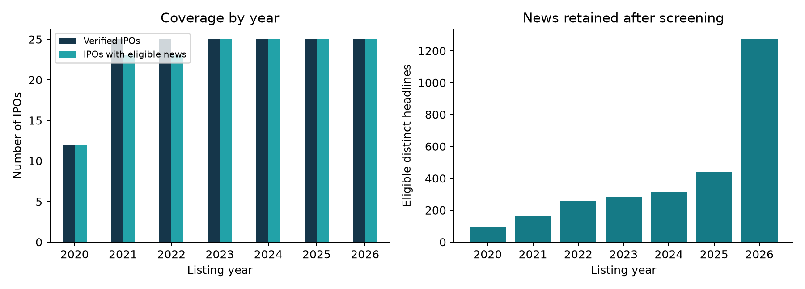
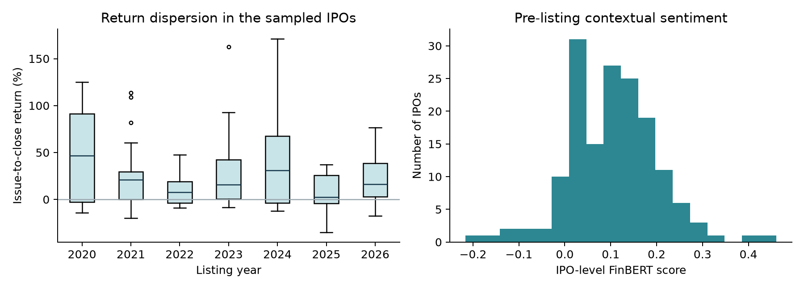
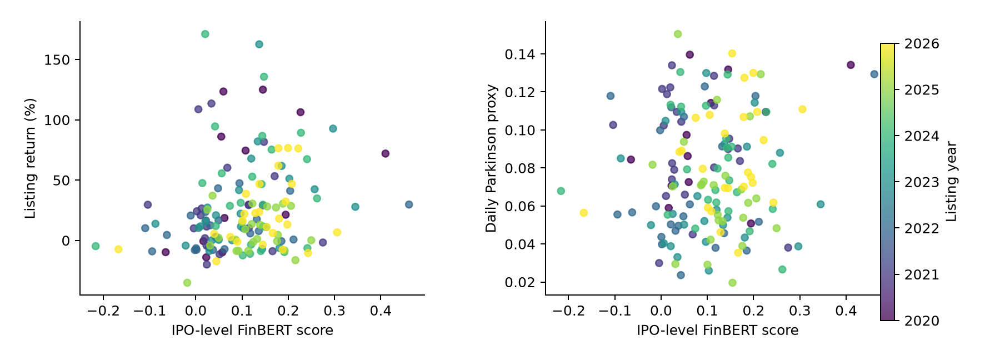

Financial News Sentiment
and IPO Listing-Day
Performance

Evidence from NSE mainboard IPOs, 2020-2026

PROJECT REPORT

Naseef E. P.
31 October 2026

| Period | Verified IPOs | IPOs analysed | Eligible headlines |
|---|---|---|---|

| 2020-2026 YTD | 162 | 158 | 2830 |

A comparative study of contextual FinBERT sentiment and the Loughran-McDonald financial dictionary, using dated pre-listing news headlines and official exchange prices.

2026 coverage is year to date, with a collection cutoff of 31 October 2026. The sample is defined from the available NSE past-issues feed and should not be read as a census of every Indian IPO.

### Report structure

Abstract; introduction and objectives; literature review; sample design; data collection and verification; measurement and empirical strategy; descriptive results; regression results; 2026 prediction test; sensitivity and diagnostics; discussion and conclusion; reproduction guide; references; annual IPO and news-count appendices.

## Abstract

This project examines whether financial news sentiment before an IPO is associated with its listing-day performance on the National Stock Exchange of India. The dataset covers 162 price-verified mainboard IPOs listed between 2020 and 2026, with 2026 observed only up to the collection cutoff. Date-stratified selection targets up to 25 verified IPOs per year, while retaining all eligible candidates in smaller years. Historical news is retrieved through multiple issuer-name and date-window searches. After local timestamp, relevance and duplicate checks, 2,830 distinct headline observations remain for 158 IPOs. Headlines are scored separately with ProsusAI FinBERT and the official Loughran-McDonald dictionary. Company sentiment is the equal-weighted mean of the eligible headline scores.

The two outcomes are the listing-day closing return relative to the issue price and the daily Parkinson high-low proxy. Controlled OLS includes log issue price, log headline count, listing-year indicators and a within-year date trend. HC3 standard errors and a four-test Holm correction are used for the primary sentiment coefficients. A separate calendar holdout fits prediction models on pre-2026 IPOs and tests them on the available 2026 IPOs.

The controlled FinBERT return coefficient is 79.628, with an unadjusted p-value of 0.0018 and a Holm-adjusted p-value of 0.0073. 1 of the four controlled sentiment tests passes the Holm-adjusted five per cent threshold. FinBERT's return model does not improve 2026 test RMSE over the historical-mean baseline in this sample. LM matches no positive or negative word in 2,489 of 2,830 retained headlines, which limits the resolution of its polarity measure.

The results distinguish text measurement, in-sample association and out-of-sample prediction. They do not identify a causal effect of media coverage and do not, by themselves, establish market efficiency or a profitable trading strategy. The main contribution is a reproducible multi-year comparison with explicit price verification, news-date screening and year-wise coverage reporting.

Keywords: initial public offerings; NSE; financial news; FinBERT; Loughran-McDonald; listing return; sentiment analysis; reproducibility.

## 1. Introduction and research objectives

An initial public offering allows a company to offer its shares to public investors before exchange trading begins. The difference between the issue price and the first closing price can be substantial. Financial reporting before listing discusses the business, valuation, subscription demand, risks and expected market reception. This creates a measurable question: does the tone of that reporting help explain the first trading day?

The question requires care because favourable news may reflect information that investors already know. News may also be written in response to subscription demand or grey-market expectations. A positive relationship between news tone and a listing gain would therefore be an association, rather than evidence that the reporting caused the gain.

### Problem statement

A general sentiment dictionary may miss finance-specific meaning, while a contextual model may interpret a headline more flexibly. At the same time, a sophisticated model cannot repair a news corpus containing articles published after the outcome. This project studies both the measurement choice and the information window, across different listing years.

| Objective | How it is addressed |
|---|---|

| Cover different market periods | Select IPOs from each year from 2020 through 2026 YTD, using listing dates before outcomes are analysed. |

| Build an auditable information set | Match official listing-day prices and retain only relevant, distinct pre-listing headlines. |

| Compare sentiment measures | Score the same headlines with FinBERT and LM, retaining probabilities and dictionary coverage. |

| Test association and prediction | Estimate controlled regressions and evaluate a separate 2026 chronological test set. |

| Make the study reproducible | Publish source code, input metadata, exclusion records, tables, figures and the report. |

### Research hypotheses

H1: pre-listing headline sentiment is associated with the issue-to-close listing return. H2: pre-listing sentiment is associated with the daily high-low volatility proxy. Both are tested against zero-coefficient null hypotheses using two-sided tests. Four controlled sentiment tests arise because each hypothesis is evaluated with two sentiment methods.

## 2. Review of relevant literature

Textual analysis in finance connects language with information, expectations and market activity. The literature also shows that the appropriate method depends on the document type and the research objective. A model that classifies textual tone accurately does not necessarily forecast returns accurately.

| Study | Contribution and relevance |
|---|---|

| Loughran and McDonald (2011) | Using US 10-K filings, the authors show that a general dictionary misclassifies common financial language. Their financial word lists provide an interpretable domain-specific benchmark. |

| Araci (2019) | FinBERT adapts BERT to financial language and reports strong performance on financial sentiment benchmarks. This work is associated with the ProsusAI checkpoint used here. |

| Huang, Wang and Yang (2023) | Their FinBERT implementation outperforms LM and several alternatives on labelled analyst-report sentences, supporting contextual financial text modelling. It is a different implementation from the Prosus model. |

| Parkinson (1980) | The high-low price range provides a variance estimator under a particular price-process model. Here it supplies a daily range-based proxy when tick data are unavailable. |

For short headlines, context can change the interpretation of individual words. A statement that losses have narrowed contains a negative word but may describe improvement. FinBERT can use the surrounding wording, while LM records matches to a fixed vocabulary. This gives a reason to use contextual sentiment as the primary measurement approach and retain LM as a transparent comparison.

However, the cited benchmark results do not validate either method on Indian IPO headlines. This project has no independent local gold-standard sentiment labels. The comparison therefore reports coverage, score behaviour and economic associations without claiming a measured classification-accuracy advantage in this corpus.

The multi-year design addresses variation across listing periods. It also separates the explanatory regressions from the later-year prediction test. Neither design establishes a causal response to media tone, since company characteristics and investor demand may affect reporting and prices together.

## 3. Research design and annual sample

The unit of economic analysis is one IPO. Headlines are measured individually and then aggregated within the IPO. The sampling frame consists of EQ issues from the NSE past-issues response with listing dates from 2020 to the 2026 cutoff. Offer opening must precede listing by no more than 90 days; this helps reject later exchange migrations or inconsistent date records.

Within each year, the collector targets up to 25 IPOs at evenly spaced ranks in the chronological listing-date order. If a selected record fails price verification, the remaining chronological candidates serve as reserves. No return, sentiment score, p-value or observed headline count is used to choose the original date strata. Missing news does not cause an IPO to be silently replaced.

| Year | Eligible frame | Verified IPOs | With news | Headlines | Median / IPO |
|---|---|---|---|---|---|

| 2020 | 12 | 12 | 12 | 95 | 6.0 |

| 2021 | 56 | 25 | 23 | 165 | 6.0 |

| 2022 | 33 | 25 | 23 | 260 | 7.0 |

| 2023 | 47 | 25 | 25 | 284 | 10.0 |

| 2024 | 72 | 25 | 25 | 315 | 12.0 |

| 2025 | 82 | 25 | 25 | 439 | 18.0 |

| 2026 YTD | 81 | 25 | 25 | 1272 | 59.0 |

The resulting panel has 162 verified IPOs and 158 IPOs with eligible headlines. Price-only observations remain visible in the panel and appendices but are excluded from sentiment regressions. The sample is larger than a fixed ten-per-year design while preserving representation from each available year.

The annual counts are not population weights. Because the target is similar across years, a year with many IPOs contributes a smaller sampled fraction than a quieter year. The pooled estimates describe this sampled panel, not an average over every Indian IPO issued during the period.

## 4. Data collection and quality controls

### Official financial data

Listing-day prices are read from dated NSE bhavcopies. The collector supports both the legacy format and the UDiFF format used for later dates. It requires an exact trading-date match and one EQ-series identity match. Official symbol-change records allow documented ticker renames to be followed; the historic bhavcopy symbol and ISIN are retained.

The final issue price in the NSE issue feed must agree with the first-day reference-price field to within INR 0.005. Open, high, low and close must be finite, positive and internally consistent. These checks protect the return calculation from using a modern split-adjusted quote against the original issue price. A neighbouring trading date is never substituted.

### Historical news discovery

The collection uses 602 distinct dated queries, including full issuer names, declared distinctive aliases and split-window searches. Additional short-name queries use prefixes unique within the eligible issuer frame, plus documented abbreviations. Publisher names, original RSS URLs, query identifiers, retrieval records and source-response hashes are retained. The analysis uses headlines, not full article bodies.

| Screening stage / first rejection reason | Number of rows |
|---|---|

| Raw candidate rows | 11247 |

| Eligible distinct headlines | 2830 |

| Duplicate | 4077 |

| Relevance not verified | 2265 |

| At or after cutoff | 2075 |

A headline must fall in the local pre-listing window, match a declared issuer name or alias, contain IPO, and have a source and URL. Identical URLs or normalised headline text are deduplicated within each IPO. Publisher suffixes are removed before title comparison. The audit gives each excluded row its first rejection reason, so counts should not be read as overlapping categories.

Retrospective RSS searches can miss older articles, repeat syndicated reporting or expose updated metadata. Extra queries improve retrieval coverage, but do not turn the corpus into a complete archive or guarantee independent observations.

## 5. Sentiment and outcome measurement

The primary information window is the 30 calendar days immediately before listing-day midnight in Asia/Kolkata. Dates with timezone offsets are converted to local time. Naive dates are interpreted locally, and all listing-day items are excluded, including those recorded only by calendar date.

| Variable | Definition and interpretation |
|---|---|

| FinBERT headline score | P(positive) minus P(negative). All three label probabilities are saved; the score is textual tone, not a probability of a future price gain. |

| LM headline score | Positive-token count minus negative-token count, divided by all alphabetic tokens. Only active positive/negative category flags are used. |

| LM coverage and uncertainty | Polarity-word matches divided by tokens; uncertainty matches are recorded separately. No polarity match is not proof of substantive neutrality. |

| IPO-level sentiment | Equal-weighted mean of the eligible article scores within each IPO. No eligible headlines gives missing sentiment. |

| Listing return (%) | 100 x (listing-day close / issue price - 1). This is the allottee issue-to-close return, expressed in percentage points. |

| Parkinson daily proxy | ln(high / low) / sqrt(4 x ln(2)), without annualisation. It measures the day's price range under the estimator's assumptions. |

Headline wording is retained for contextual inference: there is no stopword removal or stemming before FinBERT. If text exceeds the model capacity, it is divided into token chunks and class probabilities are averaged. IPO aggregation gives each headline equal weight, rather than allowing a single long text to dominate the company score.

The dictionary is the official 1993-2025 master edition downloaded from the authors. FinBERT uses an immutable model revision. Both vintages are recorded in the run manifest. Applying contemporary measurement tools to older news makes this a retrospective text-measurement study; it is not a certified simulation of the exact model and data available to traders in 2020.

## 6. Empirical strategy

### Association models

For each outcome and sentiment method, the project estimates a simple OLS regression and a controlled regression. The controlled specification is:

Outcome = intercept + sentiment + log(issue price) + log(1 + headline count) + listing-year indicators + within-year listing-date trend.

Year indicators allow the average outcome to differ across listing periods. The within-year trend is day of year divided by 365.25. Log issue price controls for an observable price level, not firm size or valuation in a complete economic sense. Headline count accounts partly for variation in measured attention, although it may itself be endogenous.

Standard errors use HC3 and t-based pointwise 95% confidence intervals. Singular designs, inadequate residual degrees of freedom and unit-leverage cases are rejected rather than reported as valid inference. The four controlled sentiment coefficients form the primary Holm-adjustment family: two methods multiplied by two outcomes. Correlations and simple regressions are exploratory.

### Predeclared 2026 prediction test

The prediction split is 1 January 2026. Models are fitted using only earlier IPOs and evaluated on the 25 covered IPOs listed in 2026; 133 covered IPOs form the training sample. This keeps whole listing dates together. No 2026 outcome is used to estimate the prediction coefficients.

Three predictions are compared on identical test rows: the historical training mean, a controls-only OLS model, and the same controls plus one sentiment score. Forecasting controls are log issue price and log headline count. Future-year dummy coefficients are not estimated. Mean absolute error and root mean squared error are reported for both outcomes.

### Sensitivity and dependence

Exploratory checks use a 14-day window, exclude explicitly named GMP or grey-market headlines, require at least five eligible headlines per IPO, and exclude 2026 from association estimation. HC3 handles heteroskedasticity, but does not remove omitted variables or all possible dependence among IPOs exposed to common market shocks.

## 7. Descriptive findings

| Variable: covered IPOs | N | Mean | Median | Std. dev. |
|---|---|---|---|---|

| Listing return (%) | 158 | 24.9498 | 13.6672 | 36.9134 |

| Daily Parkinson proxy | 158 | 0.0782 | 0.0727 | 0.0305 |

| FinBERT IPO sentiment | 158 | 0.1046 | 0.1074 | 0.0983 |

| LM IPO sentiment | 158 | 0.0070 | 0.0000 | 0.0189 |

| Headlines per IPO | 158 | 17.9114 | 11.5000 | 19.2392 |

The coverage chart separates the verified financial panel from the subset with eligible news. News counts are the distinct headline observations after filtering, rather than the raw number of search results. A missing-news IPO is not assigned a neutral score. This distinction matters when comparing quieter and more heavily reported listing years.

The range of issue-to-close returns and the distribution of company sentiment should be considered before reading a single coefficient. Descriptive annual differences can reflect the selected sample, issuer mix, market conditions and retrieval coverage. They are not a census-based comparison of annual IPO market performance.

## 8. Distributions and visual relationships

The return boxplots show dispersion within the sampled listing years. FinBERT company scores are the mean of pre-listing headlines. These figures describe the data and do not control for differences in issue price, headline count or listing year.

Each scatter point represents one covered IPO; colours identify listing years. The two panels use the same sentiment score with different outcomes. A visible relationship in a pooled scatter can partly reflect between-year composition. The controlled regressions and the separate prediction test provide the more specific comparisons below.

There is no rule that adding headlines must strengthen a relationship or make a p-value smaller. Extra observations are useful when they improve measurement and coverage; repeated or irrelevant observations can instead obscure the information of interest.

## 9. Primary regression results

| Method | Outcome | Coefficient | 95% HC3 CI | Raw p | Holm p |
|---|---|---|---|---|---|

| FinBERT | Return (%) | 79.628 | [30.044, 129.212] | 0.0018 | 0.0073 |

| FinBERT | Daily proxy | 0.033 | [-0.026, 0.092] | 0.2735 | 0.5470 |

| LM | Return (%) | 302.325 | [-140.174, 744.824] | 0.1790 | 0.5371 |

| LM | Daily proxy | 0.160 | [-0.200, 0.520] | 0.3814 | 0.5470 |

1 of the four controlled sentiment tests passes the Holm-adjusted five per cent threshold. The controlled FinBERT return estimate is 79.628. A 0.1-unit increase in its score corresponds to an estimated 7.96 percentage-point difference in return, holding the stated controls fixed. The coefficient's pointwise interval is [30.044, 129.212] per one score unit. These intervals are not simultaneous multiplicity-adjusted intervals.

For the controlled FinBERT return model, total R-squared is 0.195 and adjusted R-squared is 0.141. This describes the complete specification; it is not the fraction explained by sentiment alone. The larger set of year controls also consumes degrees of freedom, so adjusted fit and uncertainty matter alongside raw fit.

### Exploratory correlations

| Method | Outcome | Pearson r | Pearson p | Spearman r |
|---|---|---|---|---|

| FinBERT | Return (%) | 0.212 | 0.0074 | 0.250 |

| FinBERT | Daily proxy | 0.062 | 0.4364 | 0.037 |

| LM | Return (%) | 0.192 | 0.0157 | 0.216 |

| LM | Daily proxy | 0.143 | 0.0728 | 0.048 |

The correlation table does not control for year or other variables and its p-values are not part of the primary Holm family. Comparing a correlation with a controlled coefficient can reveal how sensitive the pooled relationship is to observable differences, but does not establish why the relationship changes.

## 10. Prediction on 2026 IPOs

The pre-2026 training group contains 133 IPOs and the 2026 test group contains 25. All predictors for a given outcome are evaluated on the same companies. 2026 is a partial year, and this held-out period should not be treated as a complete future market cycle.

### Issue-to-close return: errors in percentage points

| Predictor | MAE | RMSE |
|---|---|---|

| Historical training mean | 23.37 | 27.75 |

| Controls only | 26.11 | 29.60 |

| Controls + FinBERT | 24.57 | 27.87 |

| Controls + LM | 25.40 | 28.83 |

### Daily Parkinson proxy: errors in daily units

| Predictor | MAE | RMSE |
|---|---|---|

| Historical training mean | 0.0226 | 0.0280 |

| Controls only | 0.0280 | 0.0347 |

| Controls + FinBERT | 0.0277 | 0.0345 |

| Controls + LM | 0.0277 | 0.0344 |

FinBERT's return model does not improve 2026 test RMSE over the historical-mean baseline in this sample. MAE and RMSE may rank predictors differently because RMSE places greater weight on large errors. The tables give error magnitudes, rather than a test of profitable trading after allocation constraints, risk adjustment and transaction costs.

The test design improves separation between fitting and evaluation, but historical search retrieval and contemporary text-model vintages still prevent a claim that these are fully point-in-time investable forecasts. A further later-year test would be needed after the measurement and specification are fixed.

## 11. Sensitivity and diagnostic checks

### Controlled return coefficients: exploratory specifications

| Specification | Method | N | Coefficient | Holm p |
|---|---|---|---|---|

| 14-day window | FinBERT | 158 | 81.83 | 0.0026 |

| 14-day window | LM | 158 | 288.11 | 0.3606 |

| Exclude GMP titles | FinBERT | 158 | 46.40 | 0.2853 |

| Exclude GMP titles | LM | 158 | 232.45 | 0.7777 |

| At least 5 headlines | FinBERT | 135 | 94.17 | 0.0277 |

| At least 5 headlines | LM | 135 | 459.68 | 0.2096 |

| 2020-2025 only | FinBERT | 133 | 72.12 | 0.0458 |

| 2020-2025 only | LM | 133 | 280.59 | 0.6309 |

The complete sensitivity table also includes the daily range outcome. Holm adjustment is applied within each specification, not across every exploratory analysis. These checks should be read as evidence about stability; the project does not select the most favourable specification as its final result.

### Influential observations: primary FinBERT return model

| Symbol | Cook's distance | Leverage |
|---|---|---|

| BLSE | 0.121 | 0.072 |

| TATATECH | 0.083 | 0.063 |

| GRINFRA | 0.074 | 0.080 |

| BAJAJHFL | 0.055 | 0.102 |

Cook's distance and leverage identify observations that warrant review of the source and specification. They are not grounds to remove a large or inconvenient return after observing it. The untrimmed sample remains the primary analysis.

## 12. News coverage and measurement limits

LM has no active positive or negative token match in 2,489 of 2,830 headlines (88.0%). This is a coverage finding, not a measured error rate. Zero-match headlines may convey information about subscriptions, anchors or valuations without using the dictionary's polarity vocabulary.

| Largest publisher labels in the retained RSS corpus | Headlines |
|---|---|

| Moneycontrol.com | 523 |

| Livemint | 284 |

| The Economic Times | 172 |

| NDTV Profit | 129 |

| Value Research | 104 |

| Upstox | 92 |

| Business Standard | 82 |

| Business Today | 82 |

The RSS publisher label is retained as received. Some labels can refer to brands or sections rather than a harmonised publisher identity. The project therefore does not present these counts as a comprehensive measure of media-market concentration. Syndicated stories with materially different titles can remain after exact deduplication.

Across covered IPOs, the median headline count is 11.5, with a range from 1 to 92. Company sentiment based on one or two headlines is less well measured than sentiment based on a richer corpus. The minimum-five-headline sensitivity addresses part of this problem, although it may favour larger or more prominent offerings.

The broader collection adds observations across years, but differences in retrieval success are not random. Older reporting may be less discoverable, and the exact-alias rule can miss brand-only headlines. These limitations are made visible through per-IPO counts, query logs and missing-coverage records rather than hidden by assigning neutral values.

## 13. Discussion, conclusion and further work

The project brings together a multi-year financial panel and a dated headline corpus to compare contextual and dictionary sentiment. 1 of the four controlled sentiment tests passes the Holm-adjusted five per cent threshold. FinBERT's return model does not improve 2026 test RMSE over the historical-mean baseline in this sample. These are the conclusions for the specified sample and models; they should not be generalised to every IPO or every form of financial text.

The contextual and dictionary approaches measure different aspects of language. FinBERT uses the surrounding wording, while LM makes its word-level mechanism easy to inspect. Dictionary sparsity can weaken its resolution on short headlines. But the project cannot declare a local accuracy winner without independent human labels for this corpus.

The economic relationship remains observational. Subscription demand, issue characteristics, sector exposure and market conditions can influence both reporting and the listing outcome. Issue price and headline count are limited controls. Pre-listing market returns, issue size, valuation, sector indicators and subscription data would improve the design if collected with equivalent timing checks.

A null coefficient is not proof of semi-strong market efficiency. Conversely, an adjusted significant coefficient would not by itself establish an exploitable trading strategy. Issue-to-close gains depend on receiving an IPO allocation, and the model does not account for allocation probabilities, financing constraints, risk-adjusted benchmarks or trading costs.

### Priorities for further research

First, obtain a timestamped archive or licensed news source to assess retrieval completeness. Second, independently label a sample of headlines and evaluate agreement, macro-F1 and domain-specific mistakes. Third, collect stronger pre-listing controls and use larger later-year tests. Fourth, examine time-block dependence and robustness with more complete annual samples. These extensions should be specified before comparing results.

The reproducible contribution is practical: every included IPO has a documentary price source; every candidate headline has a timestamp and an inclusion decision; both sentiment methods use the same retained corpus; and the report is generated from the saved results.

## 14. Reproduction and project organisation

| Location | Purpose |
|---|---|

| data/research/ | Frozen IPO, price and news inputs; complete sampling frame, declared aliases, query logs and source hashes. |

| src/iposent/ | Validation, headline measurement, IPO aggregation, association models and chronological predictions. |

| scripts/ | Source collection, alias enrichment, sensitivity checks, figures, report generation and release packaging. |

| results/ | Article scores, price/news audits, per-IPO counts, yearly coverage, coefficients, diagnostics and test predictions. |

| notebooks/ipo_sentiment.ipynb | A local Jupyter and Colab walkthrough that loads the public repository automatically. |

| tests/ and .github/workflows/ | Offline regression checks and continuous integration without model downloads. |

Open the notebook through the repository's Open in Colab link and save a copy to Drive. Run the setup cell, inspect the frozen results, install the package and dictionary, then run the analysis. The notebook uses a fresh output directory, so it does not mix new outputs with the published snapshot.

For a command-line reproduction, install the FinBERT extra, obtain the official dictionary, and run the command in README.md using the three data/research input CSVs, --model both and --holdout-from 2026-01-01. Live source collection is optional; published inputs provide the frozen study and may differ from future search results.

The offline tests cover date/timezone boundaries, exact price dates, OHLC validation, duplicates including publisher suffixes, missing news, removed dictionary flags, date-stratified sampling, declared aliases and chronological holdouts. The verification script checks input hashes, class probabilities, per-year coverage and train/test dates.

FinBERT revision: 0bc2ac10dda6929bcb1f77ccc43c7ec5c424f031

LM CSV SHA-256: 147cb24a1687ccde60363a0fa29c62be4097debcc698c01a83e51bb8a176dbb3

Model weights and the dictionary are not redistributed in the source ZIP. Their original terms remain applicable; see THIRD_PARTY_NOTICES.md. Original project code has its own MIT license.

## References and source access

Araci, D. (2019). FinBERT: Financial Sentiment Analysis with Pre-trained Language Models. arXiv:1908.10063.

<link href="https://arxiv.org/abs/1908.10063" color="#157a86">Source link</link>

https://arxiv.org/abs/1908.10063

Huang, A. H., Wang, H., and Yang, Y. (2023). FinBERT: A Large Language Model for Extracting Information from Financial Text. Contemporary Accounting Research, 40(2), 806-841.

<link href="https://doi.org/10.1111/1911-3846.12832" color="#157a86">Source link</link>

https://doi.org/10.1111/1911-3846.12832

Loughran, T., and McDonald, B. (2011). When Is a Liability Not a Liability? Textual Analysis, Dictionaries, and 10-Ks. Journal of Finance, 66(1), 35-65.

<link href="https://doi.org/10.1111/j.1540-6261.2010.01625.x" color="#157a86">Source link</link>

https://doi.org/10.1111/j.1540-6261.2010.01625.x

Parkinson, M. (1980). The Extreme Value Method for Estimating the Variance of the Rate of Return. Journal of Business, 53(1), 61-65.

<link href="https://doi.org/10.1086/296071" color="#157a86">Source link</link>

https://doi.org/10.1086/296071

ProsusAI. FinBERT model card, label mapping and usage terms. Immutable revision recorded in the manifest.

<link href="https://huggingface.co/ProsusAI/finbert" color="#157a86">Source link</link>

https://huggingface.co/ProsusAI/finbert

Notre Dame SRAF. Loughran-McDonald Master Dictionary, 1993-2025 edition. Official source and academic-use information.

<link href="https://sraf.nd.edu/loughranmcdonald-master-dictionary/" color="#157a86">Source link</link>

https://sraf.nd.edu/loughranmcdonald-master-dictionary/

National Stock Exchange of India. Public past-issues feed, symbol-change records and dated equity bhavcopies. Exact URLs, query parameters and source hashes accompany the dataset.

<link href="https://www.nseindia.com/all-reports" color="#157a86">Source link</link>

https://www.nseindia.com/all-reports

Google News RSS and named publishers. Historical headline metadata. Article timestamps, publisher labels and URLs are retained in the input and audit files.

<link href="https://news.google.com/" color="#157a86">Source link</link>

https://news.google.com/

statsmodels. OLS robust covariance documentation, including HC3 and t-based inference.

<link href="https://www.statsmodels.org/stable/generated/statsmodels.regression.linear_model.OLSResults.get_robustcov_results.html" color="#157a86">Source link</link>

https://www.statsmodels.org/stable/generated/statsmodels.regression.linear_model.OLSResults.get_robustcov_results.html

## Appendix: 2020 IPOs and news coverage

12 verified IPOs; 12 with eligible news; 95 distinct headline observations. A zero count means the IPO is retained in the price panel but excluded from sentiment regressions.

| Company (shortened where needed) | Symbol | Listing date | Headlines | Return (%) |
|---|---|---|---|---|

| SBI Cards and Payment Services Limited | SBICARD | 2020-03-16 | 14 | -9.75 |

| Rossari Biotech Limited | ROSSARI | 2020-07-23 | 4 | 74.51 |

| Happiest Minds Technologies Limited | HAPPSTMNDS | 2020-09-17 | 11 | 123.46 |

| Route Mobile Limited | ROUTE | 2020-09-21 | 2 | 86.09 |

| Chemcon Speciality Chemicals Limited | CHEMCON | 2020-10-01 | 6 | 72.00 |

| Angel Broking Limited | ANGELBRKG | 2020-10-05 | 3 | -9.87 |

| Mazagon Dock Shipbuilders Limited | MAZDOCK | 2020-10-12 | 6 | 18.59 |

| UTI Asset Management Company Limited | UTIAMC | 2020-10-12 | 10 | -14.04 |

| Equitas Small Finance Bank Limited | EQUITASBNK | 2020-11-02 | 6 | -0.61 |

| Gland Pharma Limited | GLAND | 2020-11-20 | 5 | 21.30 |

| Burger King India Limited | BURGERKING | 2020-12-14 | 11 | 125.00 |

| Mrs. Bectors Food Specialities Limited | BECTORFOOD | 2020-12-24 | 17 | 106.32 |

Full company names, source URLs, original headline metadata and both sentiment scores are available in the accompanying CSVs. Returns are in percentage points and are not annualised.

## Appendix: 2021 IPOs and news coverage

25 verified IPOs; 23 with eligible news; 165 distinct headline observations. A zero count means the IPO is retained in the price panel but excluded from sentiment regressions.

| Company (shortened where needed) | Symbol | Listing date | Headlines | Return (%) |
|---|---|---|---|---|

| Antony Waste Handling Cell Limited | AWHCL | 2021-01-01 | 6 | 29.32 |

| Home First Finance Company India Limited | HOMEFIRST | 2021-02-03 | 6 | 1.84 |

| Heranba Industries Limited | HERANBA | 2021-03-05 | 4 | 29.60 |

| Easy Trip Planners Limited | EASEMYTRIP | 2021-03-19 | 4 | 11.47 |

| Laxmi Organic Industries Limited | LXCHEM | 2021-03-25 | 5 | 26.50 |

| Suryoday Small Finance Bank Limited | SURYODAY | 2021-03-26 | 9 | -8.92 |

| Macrotech Developers Limited | LODHA | 2021-04-19 | 1 | -4.27 |

| Sona BLW Precision Forgings Limited | SONACOMS | 2021-06-24 | 1 | 24.12 |

| Krishna Institute of Medical Sciences Limited | KIMS | 2021-06-28 | 3 | 20.84 |

| G R Infraprojects Limited | GRINFRA | 2021-07-19 | 1 | 108.73 |

| Tatva Chintan Pharma Chem Limited | TATVA | 2021-07-29 | 6 | 113.50 |

| Rolex Rings Limited | ROLEXRINGS | 2021-08-09 | 15 | 29.67 |

| Windlas Biotech Limited | WINDLAS | 2021-08-16 | 12 | -11.49 |

| Aptus Value Housing Finance India Limited | APTUS | 2021-08-24 | 7 | -1.73 |

| Ami Organics Limited | AMIORG | 2021-09-14 | 13 | 53.28 |

| Sansera Engineering Limited | SANSERA | 2021-09-24 | 12 | 10.02 |

| FINO Payments Bank Limited | FINOPB | 2021-11-12 | 11 | -5.74 |

| S J S Enterprises Limited | SJS | 2021-11-15 | 0 | -5.87 |

| Sapphire Foods India Limited | SAPPHIRE | 2021-11-18 | 7 | 2.67 |

| Go Fashion (India) Limited | GOCOLORS | 2021-11-30 | 7 | 81.70 |

| Tega Industries Limited | TEGA | 2021-12-13 | 11 | 60.28 |

| RateGain Travel Technologies Limited | RATEGAIN | 2021-12-17 | 3 | -19.99 |

| C.E. Info Systems Limited | MAPMYINDIA | 2021-12-21 | 0 | 34.91 |

| Data Patterns (India) Limited | DATAPATTNS | 2021-12-24 | 12 | 29.06 |

| CMS Info Systems Limited | CMSINFO | 2021-12-31 | 9 | 10.28 |

Full company names, source URLs, original headline metadata and both sentiment scores are available in the accompanying CSVs. Returns are in percentage points and are not annualised.

## Appendix: 2022 IPOs and news coverage

25 verified IPOs; 23 with eligible news; 260 distinct headline observations. A zero count means the IPO is retained in the price panel but excluded from sentiment regressions.

| Company (shortened where needed) | Symbol | Listing date | Headlines | Return (%) |
|---|---|---|---|---|

| AGS Transact Technologies Limited | AGSTRA | 2022-01-31 | 1 | -7.97 |

| Adani Wilmar Limited | AWL | 2022-02-08 | 14 | 16.63 |

| Vedant Fashions Limited | MANYAVAR | 2022-02-16 | 14 | 7.80 |

| Campus Activewear Limited | CAMPUS | 2022-05-09 | 4 | 29.76 |

| Rainbow Childrens Medicare Limited | RAINBOW | 2022-05-10 | 0 | -16.94 |

| Life Insurance Corporation of India | LICI | 2022-05-17 | 89 | -7.77 |

| Delhivery Limited | DELHIVERY | 2022-05-24 | 15 | 10.13 |

| Paradeep Phosphates Limited | PARADEEP | 2022-05-27 | 11 | 4.52 |

| eMudhra Limited | EMUDHRA | 2022-06-01 | 5 | 0.74 |

| Aether Industries Limited | AETHER | 2022-06-03 | 5 | 20.62 |

| Syrma SGS Technology Limited | SYRMA | 2022-08-26 | 9 | 41.14 |

| Harsha Engineers International Limited | HARSHA | 2022-09-26 | 10 | 47.42 |

| Electronics Mart India Limited | EMIL | 2022-10-17 | 5 | 43.22 |

| Tracxn Technologies Limited | TRACXN | 2022-10-20 | 4 | 16.56 |

| Global Health Limited | MEDANTA | 2022-11-16 | 8 | 23.60 |

| Bikaji Foods International Limited | BIKAJI | 2022-11-16 | 10 | 5.82 |

| Archean Chemical Industries Limited | ACI | 2022-11-21 | 3 | 12.57 |

| Kaynes Technology India Limited | KAYNES | 2022-11-22 | 7 | 17.54 |

| Inox Green Energy Services Limited | INOXGREEN | 2022-11-23 | 4 | -9.08 |

| Keystone Realtors Limited | RUSTOMJEE | 2022-11-24 | 5 | 2.93 |

| Uniparts India Limited | UNIPARTS | 2022-12-12 | 3 | -6.47 |

| Sula Vineyards Limited | SULA | 2022-12-22 | 18 | -7.23 |

| Abans Holdings Limited | AHL | 2022-12-23 | 0 | -19.11 |

| KFin Technologies Limited | KFINTECH | 2022-12-29 | 8 | -0.59 |

| Elin Electronics Limited | ELIN | 2022-12-30 | 8 | -7.83 |

Full company names, source URLs, original headline metadata and both sentiment scores are available in the accompanying CSVs. Returns are in percentage points and are not annualised.

## Appendix: 2023 IPOs and news coverage

25 verified IPOs; 25 with eligible news; 284 distinct headline observations. A zero count means the IPO is retained in the price panel but excluded from sentiment regressions.

| Company (shortened where needed) | Symbol | Listing date | Headlines | Return (%) |
|---|---|---|---|---|

| Radiant Cash Management Services Limited | RADIANTCMS | 2023-01-04 | 3 | 11.60 |

| Avalon Technologies Limited | AVALON | 2023-04-18 | 15 | -8.72 |

| IKIO Lighting Limited | IKIO | 2023-06-16 | 12 | 41.70 |

| Ideaforge Technology Limited | IDEAFORGE | 2023-07-07 | 19 | 92.70 |

| Senco Gold Limited | SENCO | 2023-07-14 | 14 | 27.85 |

| Netweb Technologies India Limited | NETWEB | 2023-07-27 | 7 | 82.08 |

| SBFC Finance Limited | SBFC | 2023-08-16 | 8 | 61.75 |

| Concord Biotech Limited | CONCORDBIO | 2023-08-18 | 15 | 27.23 |

| Aeroflex Industries Limited | AEROFLEX | 2023-08-31 | 12 | 51.16 |

| Rishabh Instruments Limited | RISHABH | 2023-09-11 | 7 | 0.49 |

| R R Kabel Limited | RRKABEL | 2023-09-20 | 2 | 15.75 |

| SAMHI Hotels Limited | SAMHI | 2023-09-22 | 7 | 13.81 |

| Sai Silks (Kalamandir) Limited | KALAMANDIR | 2023-09-27 | 13 | 10.32 |

| Yatra Online Limited | YATRA | 2023-09-28 | 1 | -4.30 |

| Manoj Vaibhav Gems N Jewellers Limited | MVGJL | 2023-10-03 | 7 | 0.23 |

| IRM ENERGY LIMITED | IRMENERGY | 2023-10-26 | 9 | -6.31 |

| Cello World Limited | CELLO | 2023-11-06 | 8 | 22.18 |

| ASK Automotive Limited | ASKAUTOLTD | 2023-11-15 | 14 | 9.96 |

| Fedbank Financial Services Limited | FEDFINA | 2023-11-30 | 10 | 0.18 |

| Tata Technologies Limited | TATATECH | 2023-11-30 | 31 | 162.60 |

| DOMS Industries Limited | DOMS | 2023-12-20 | 19 | 67.85 |

| INOX India Limited | INOXINDIA | 2023-12-21 | 14 | 42.42 |

| Suraj Estate Developers Limited | SURAJEST | 2023-12-26 | 8 | -7.08 |

| Credo Brands Marketing Limited | MUFTI | 2023-12-27 | 10 | 11.50 |

| Innova Captab Limited | INNOVACAP | 2023-12-29 | 19 | 20.85 |

Full company names, source URLs, original headline metadata and both sentiment scores are available in the accompanying CSVs. Returns are in percentage points and are not annualised.

## Appendix: 2024 IPOs and news coverage

25 verified IPOs; 25 with eligible news; 315 distinct headline observations. A zero count means the IPO is retained in the price panel but excluded from sentiment regressions.

| Company (shortened where needed) | Symbol | Listing date | Headlines | Return (%) |
|---|---|---|---|---|

| Jyoti CNC Automation Limited | JYOTICNC | 2024-01-16 | 16 | 31.18 |

| Medi Assist Healthcare Services Limited | MEDIASSIST | 2024-01-23 | 12 | 11.03 |

| BLS E- Services Limited | BLSE | 2024-02-06 | 9 | 171.11 |

| Jana Small Finance Bank Limited | JSFB | 2024-02-14 | 17 | -11.07 |

| Juniper Hotels Limited | JUNIPER | 2024-02-28 | 12 | 11.53 |

| R K Swamy Limited | RKSWAMY | 2024-03-12 | 3 | -8.82 |

| Popular Vehicles and Services Limited | PVSL | 2024-03-19 | 7 | -6.39 |

| JNK India Limited | JNKINDIA | 2024-04-30 | 7 | 67.36 |

| TBO Tek Limited | TBOTEK | 2024-05-15 | 15 | 52.86 |

| Stanley Lifestyles Limited | STANLEY | 2024-06-28 | 16 | 28.66 |

| Emcure Pharmaceuticals Limited | EMCURE | 2024-07-10 | 10 | 34.84 |

| Ceigall India Limited | CEIGALL | 2024-08-08 | 12 | -3.55 |

| Unicommerce eSolutions Limited | UNIECOM | 2024-08-13 | 4 | 94.52 |

| Premier Energies Limited | PREMIERENE | 2024-09-03 | 11 | 86.64 |

| Bajaj Housing Finance Limited | BAJAJHFL | 2024-09-16 | 36 | 135.71 |

| Arkade Developers Limited | ARKADE | 2024-09-24 | 7 | 29.58 |

| Garuda Construction and Engineering Limited | GARUDA | 2024-10-15 | 10 | 11.96 |

| Waaree Energies Limited | WAAREEENER | 2024-10-28 | 25 | 55.62 |

| ACME Solar Holdings Limited | ACMESOLAR | 2024-11-13 | 13 | -12.40 |

| Zinka Logistics Solutions Limited | BLACKBUCK | 2024-11-22 | 4 | -4.74 |

| One MobiKwik Systems Limited | MOBIKWIK | 2024-12-18 | 8 | 89.25 |

| Inventurus Knowledge Solutions Limited | IKS | 2024-12-19 | 6 | 47.54 |

| DAM Capital Advisors Limited | DAMCAPITAL | 2024-12-27 | 17 | 46.68 |

| Carraro India Limited | CARRARO | 2024-12-30 | 13 | -9.63 |

| Unimech Aerospace and Manufacturing Limited | UNIMECH | 2024-12-31 | 25 | 75.32 |

Full company names, source URLs, original headline metadata and both sentiment scores are available in the accompanying CSVs. Returns are in percentage points and are not annualised.

## Appendix: 2025 IPOs and news coverage

25 verified IPOs; 25 with eligible news; 439 distinct headline observations. A zero count means the IPO is retained in the price panel but excluded from sentiment regressions.

| Company (shortened where needed) | Symbol | Listing date | Headlines | Return (%) |
|---|---|---|---|---|

| Indo Farm Equipment Limited | INDOFARM | 2025-01-07 | 28 | 27.30 |

| Laxmi Dental Limited | LAXMIDENTL | 2025-01-20 | 10 | 28.63 |

| Quality Power Electrical Equipments Limited | QPOWER | 2025-02-24 | 11 | -8.73 |

| Schloss Bangalore Limited | THELEELA | 2025-06-02 | 4 | 0.13 |

| Kalpataru Limited | KALPATARU | 2025-07-01 | 11 | 4.58 |

| CRIZAC LIMITED | CRIZAC | 2025-07-09 | 13 | 25.56 |

| Anthem Biosciences Limited | ANTHEM | 2025-07-21 | 28 | 28.13 |

| Shanti Gold International Limited | SHANTIGOLD | 2025-08-01 | 15 | 15.27 |

| Sri Lotus Developers and Realty Limited | LOTUSDEV | 2025-08-06 | 19 | 30.45 |

| JSW Cement Limited | JSWCEMENT | 2025-08-14 | 42 | -0.63 |

| Shreeji Shipping Global Limited | SHREEJISPG | 2025-08-26 | 18 | 1.23 |

| Vikran Engineering Limited | VIKRAN | 2025-09-03 | 18 | -1.33 |

| Euro Pratik Sales Limited | EUROPRATIK | 2025-09-23 | 8 | 0.56 |

| Atlanta Electricals Limited | ATLANTAELE | 2025-09-29 | 15 | 9.20 |

| Jaro Institute of Technology Management an... | JARO | 2025-09-30 | 6 | -16.38 |

| Jain Resource Recycling Limited | JAINREC | 2025-10-01 | 18 | 37.09 |

| Glottis Limited | GLOTTIS | 2025-10-07 | 5 | -35.12 |

| Canara Robeco Asset Management Company Lim... | CRAMC | 2025-10-16 | 21 | 12.95 |

| Studds Accessories Limited | STUDDS | 2025-11-07 | 13 | -4.22 |

| Pine Labs Limited | PINELABS | 2025-11-14 | 39 | 13.52 |

| Fujiyama Power Systems Limited | UTLSOLAR | 2025-11-20 | 21 | -8.58 |

| Sudeep Pharma Limited | SUDEEPPHRM | 2025-11-28 | 21 | 30.55 |

| Vidya Wires Limited | VIDYAWIRES | 2025-12-10 | 22 | 2.25 |

| Park Medi World Limited | PARKHOSPS | 2025-12-17 | 19 | -8.67 |

| Gujarat Kidney and Super Speciality Limited | GKSL | 2025-12-30 | 14 | -8.30 |

Full company names, source URLs, original headline metadata and both sentiment scores are available in the accompanying CSVs. Returns are in percentage points and are not annualised.

## Appendix: 2026 IPOs and news coverage (YTD)

25 verified IPOs; 25 with eligible news; 1,272 distinct headline observations. A zero count means the IPO is retained in the price panel but excluded from sentiment regressions.

| Company (shortened where needed) | Symbol | Listing date | Headlines | Return (%) |
|---|---|---|---|---|

| Bharat Coking Coal Limited | BHARATCOAL | 2026-01-19 | 38 | 76.43 |

| Amagi Media Labs Limited | AMAGI | 2026-01-21 | 21 | -3.53 |

| PNGS Reva Diamond Jewellery Limited | PNGSREVA | 2026-03-04 | 7 | 6.66 |

| Rajputana Stainless Limited | RSL | 2026-03-19 | 12 | -7.35 |

| Central Mine Planning & Design Institute L... | CMPDI | 2026-03-30 | 19 | -10.43 |

| Onemi Technology Solutions Limited | KISSHT | 2026-05-08 | 26 | 22.01 |

| Waterways Leisure Tourism Limited | CORDELIA | 2026-07-01 | 67 | -17.31 |

| Laser Power & Infra Limited | LASERPOWER | 2026-07-16 | 49 | 22.63 |

| Lohia Corp Limited | LCL | 2026-07-30 | 64 | 16.38 |

| MV Electrosystems Limited | MVELECTRO | 2026-08-06 | 39 | 46.82 |

| Technocraft Ventures Limited | TECHNOCRAF | 2026-08-14 | 66 | 46.77 |

| Behari Lal Engineering Limited | BLEL | 2026-08-19 | 39 | 76.21 |

| Lalithaa Jewellery Mart Limited | LALITHAA | 2026-08-24 | 64 | 23.60 |

| Gaja Alternative Asset Management Limited | GAJA | 2026-08-26 | 53 | 5.42 |

| Symbiotec Pharmalab Limited | SYMBIOTEC | 2026-09-01 | 37 | 11.10 |

| Purple Style Labs Limited | PERNIASPOP | 2026-09-07 | 76 | -1.12 |

| Glass Wall Systems (India) Limited | GLASSWALL | 2026-09-16 | 67 | 18.05 |

| Karamtara Engineering Limited | KARAMTARA | 2026-09-17 | 62 | 38.58 |

| Rentomojo Limited | RENTOMOJO | 2026-09-17 | 72 | 32.24 |

| SS Retail Limited | SSRETAIL | 2026-09-23 | 28 | 76.60 |

| A-One Steels India Limited | AONESTEELS | 2026-10-01 | 59 | 2.85 |

| German Green Steel and Power Limited | GERMAN | 2026-10-05 | 69 | -7.68 |

| HD Fire Protect Limited | HDFIRE | 2026-10-21 | 73 | 13.19 |

| Tonbo Imaging India Limited | TONBO | 2026-10-23 | 92 | 61.97 |

| Paras Healthcare Limited | PARASHLTH | 2026-10-28 | 73 | 6.15 |

Full company names, source URLs, original headline metadata and both sentiment scores are available in the accompanying CSVs. Returns are in percentage points and are not annualised.